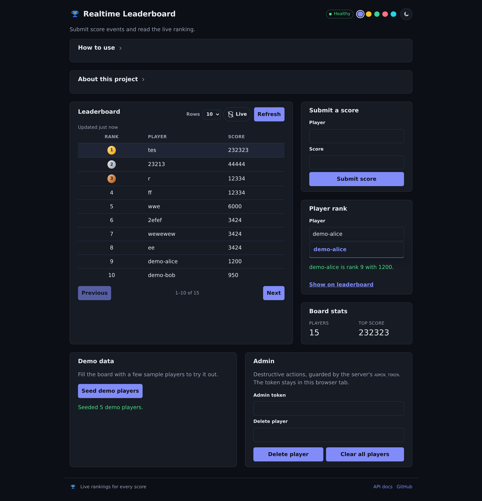
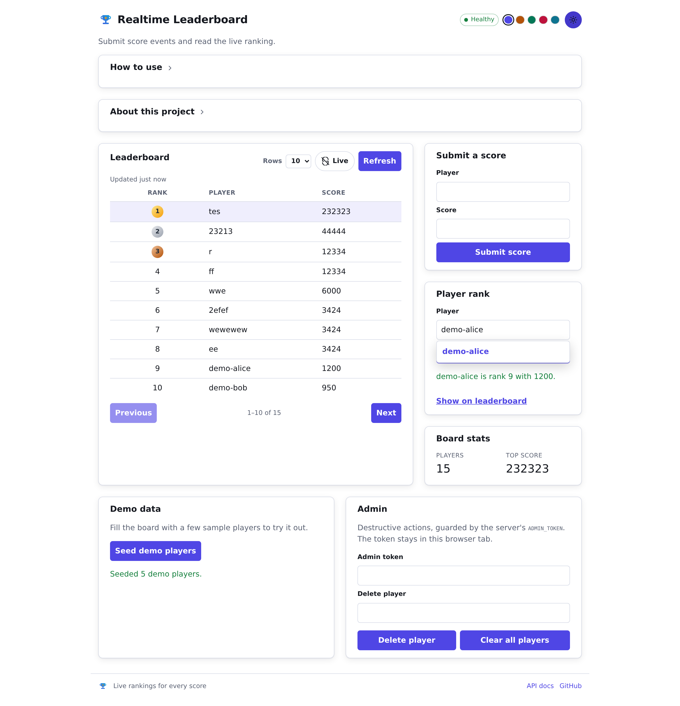

<div align="center">


# realtime-leaderboard

**A real-time leaderboard service — submit score events, read a player's rank, and page through the top of the board, with durable events in PostgreSQL and live rankings in Redis.**


</div>

| Dark (default) | Light |
|----------------|-------|
|  |  |

---

## Why this exists

Ranking a live stream of score events is awkward on a relational database alone:
an `ORDER BY score` over a growing table gets slower as the leaderboard heats up,
and a naive cache loses the event ordering that gives equal scores a stable
position.

This project splits the two concerns:

- **PostgreSQL** is the durable source of truth — every score event is stored,
  idempotently, keyed by `event_id`.
- **Redis sorted sets** serve the live reads — rank and leaderboard queries never
  touch Postgres, so they stay low-latency as the board grows.

Because the Redis board can drift, a `rebuild` binary recreates it from Postgres.

## Features

- **Score ingest** — `POST /scores`, idempotent on `event_id`; best (max) score
  per player wins, and a later lower score never demotes.
- **Stable ties** — equal scores rank the earlier event first, encoded into the
  Redis sorted-set score so ordering is consistent across reads.
- **Live rank lookup** — a player's 1-based position and best score.
- **Paged leaderboard** — `limit`/`offset` straight off the sorted set.
- **Rebuild** — recreate the Redis projection from Postgres at any time.
- **OpenAPI + Swagger UI** — generated from the handlers, served by the API.
- **React frontend** — submit a score, look up a rank, page the board; dark by
  default, with a light mode and accent presets.
- **Admin routes** — token-gated `DELETE /players/{id}` and `DELETE /scores`.

## Architecture

```text
Client (browser / curl)
  │  POST /scores
  ▼
Rust API (Axum on Tokio)
  ├─→ PostgreSQL   durable score events (sqlx; migrations on startup)
  └─→ Redis        sorted-set leaderboards (live rank + board reads)
```

Both Docker Compose services back the same API contract documented in
`backend/openapi.json`.

## Stack

| Layer          | Choice                                                        |
|----------------|---------------------------------------------------------------|
| Backend        | Rust — Axum on Tokio, queried through `sqlx`                  |
| Database       | PostgreSQL 16                                                  |
| Cache / ranking| Redis 7 (sorted sets)                                          |
| Frontend       | React 19 + TypeScript on Vite                                 |
| Frontend tests | Vitest + Testing Library + MSW                                |
| Dev environment| Docker Compose, with `mise` for toolchain pins                |

## Prerequisites

- **Rust `1.94`** — pinned in `mise.toml` and `backend/Cargo.toml`
  (`rust-version`). Install via [rustup](https://rustup.rs) or `mise install`.
- **Node `22`** — pinned in `mise.toml`; needed for the frontend.
- **PostgreSQL 16** and **Redis 7** — use the bundled Compose stack or your own.
- **Docker** (optional) — only if you want the one-command Compose stack.
- **`mise`** (optional) — installs the pinned Rust + Node toolchains.

`sqlx` checks queries at compile time. The repository commits the `.sqlx/`
offline cache, so builds work **without** a running database (that is what
`SQLX_OFFLINE=true`, used by the Makefile and CI, relies on).

## Getting started

### Option A — Docker Compose (recommended)

Brings up Postgres, Redis, the API, and the Vite dev server:

```bash
make dev-up        # docker compose up -d --build, then start Vite
```

| Service        | URL                     | Host port |
|----------------|-------------------------|-----------|
| API            | http://localhost:8082   | 8082      |
| Frontend       | http://localhost:5173   | 5173      |
| Swagger UI     | http://localhost:8082/swagger-ui/ | 8082 |
| PostgreSQL     | —                       | 5433      |
| Redis          | —                       | 6380      |

Every host port is overridable (`HOST_PORT`, `DB_HOST_PORT`,
`REDIS_HOST_PORT`, `WEB_HOST_PORT`) so two stacks can run side by side.

Handy targets:

```bash
make dev-frontend   # (re)start just the frontend dev server
make dev-frontend-log   # tail Vite
make dev-restart    # restart the API and Vite after a backend route change
make shell          # shell inside the sandbox
```

> The API port publishes as `8082` on the host but the container listens on
> `8080`; the frontend dev server proxies API calls to it, so requests are
> same-origin and no CORS layer is needed.

### Option B — Run it locally

Copy the env template and start Postgres + Redis however you like (the values in
`.env.example` point at the Compose host ports):

```bash
cp .env.example .env      # DATABASE_URL, REDIS_URL, PORT, (optional) ADMIN_TOKEN

# Backend (from backend/) — migrations run automatically on startup
cd backend
cargo run                 # http://localhost:8080

# Frontend (from frontend/) — in a second terminal
cd frontend
npm ci
API_PROXY_TARGET=http://localhost:8080 npm run dev   # http://localhost:5173
```

## Project layout

```text
backend/    # Rust API: routes, services, storage, ranking, migrations, openapi.json
frontend/   # React + TypeScript app: score submit, rank lookup, leaderboard
```

## API overview

| Method   | Path                          | Description                                  |
|----------|-------------------------------|----------------------------------------------|
| `GET`    | `/healthz`                    | Liveness/readiness for Postgres and Redis    |
| `POST`   | `/scores`                     | Submit a score event (idempotent on `event_id`) |
| `GET`    | `/leaderboard?limit=&offset=` | Page through the top of the board            |
| `GET`    | `/players/{player_id}/rank`   | A player's 1-based position and best score   |
| `GET`    | `/players?prefix=&limit=`     | Search players by id prefix (autocomplete)   |
| `GET`    | `/stats`                      | Board size and peak score                    |
| `DELETE` | `/players/{player_id}`        | Remove one player (admin, token)             |
| `DELETE` | `/scores`                     | Clear the whole board (admin, token)         |

`POST /scores` body:

```json
{ "event_id": "<uuid>", "player_id": "<id>", "score": 1234 }
```

`score` is `0..=1_000_000_000`. The response is `201` on a new event, `200` with
`"duplicate": true` on a replay of an `event_id`, and `400` on an invalid
payload.

### Interactive docs (OpenAPI / Swagger UI)

The API is described by an OpenAPI 3.1 document generated from the handler
annotations with [`utoipa`](https://docs.rs/utoipa), and served by the API
itself:

- **Swagger UI** — `http://localhost:8082/swagger-ui/` (Try it out against the
  running API).
- **Raw spec** — `http://localhost:8082/swagger-ui/api-docs/openapi.json`.

The spec is also committed as `backend/openapi.json` so it is reviewable in a
diff. Regenerate it after changing a route:

```bash
cd backend
cargo run --bin openapi     # rewrites openapi.json
```

CI runs the same command and fails if the file changes, so the document can never
drift from the code.

### Rebuilding the ranking

Redis is a projection of Postgres. If it drifts, recreate it from the source of
truth:

```bash
cd backend
cargo run --bin rebuild     # reads DATABASE_URL and REDIS_URL
```

## Development

```bash
make check          # backend (fmt + clippy + test + build) and frontend (lint + typecheck + test + build)
make dev-up         # start Postgres, Redis, the API, and the frontend
make shell          # shell inside the sandbox
```

Per component:

```bash
cd backend
cargo fmt --check
cargo clippy --all-targets -- -D warnings
cargo test
cargo build

cd ../frontend
npm run lint        # oxlint
npm run typecheck   # tsc -b
npm test            # Vitest
npm run build
```

`make check` is the gate for feature branches. GitHub Actions runs the same jobs
on `dev` → `main` pull requests.

## Author

**Felipe Inoue** — portfolio: [github.com/fiwon123/realtime-leaderboard](https://github.com/fiwon123/realtime-leaderboard)

## License

All rights reserved © 2026 Felipe Inoue. This repository is published as a
portfolio project; no reuse is granted. See [`LICENSE`](LICENSE). Third-party
dependencies remain under their own licenses.
